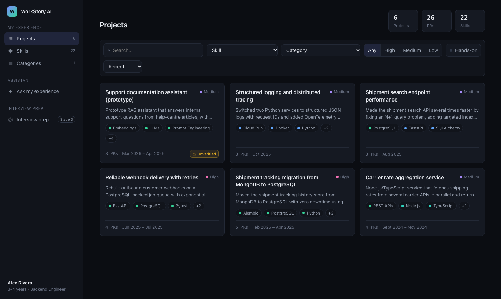
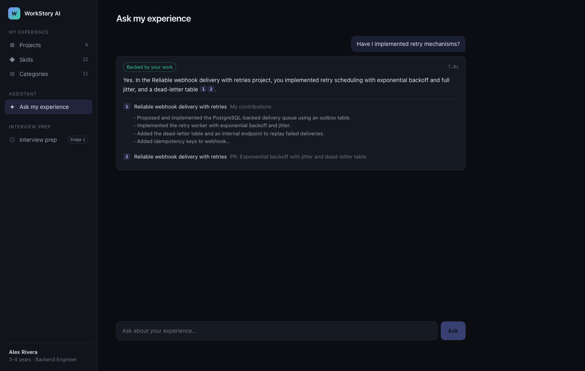
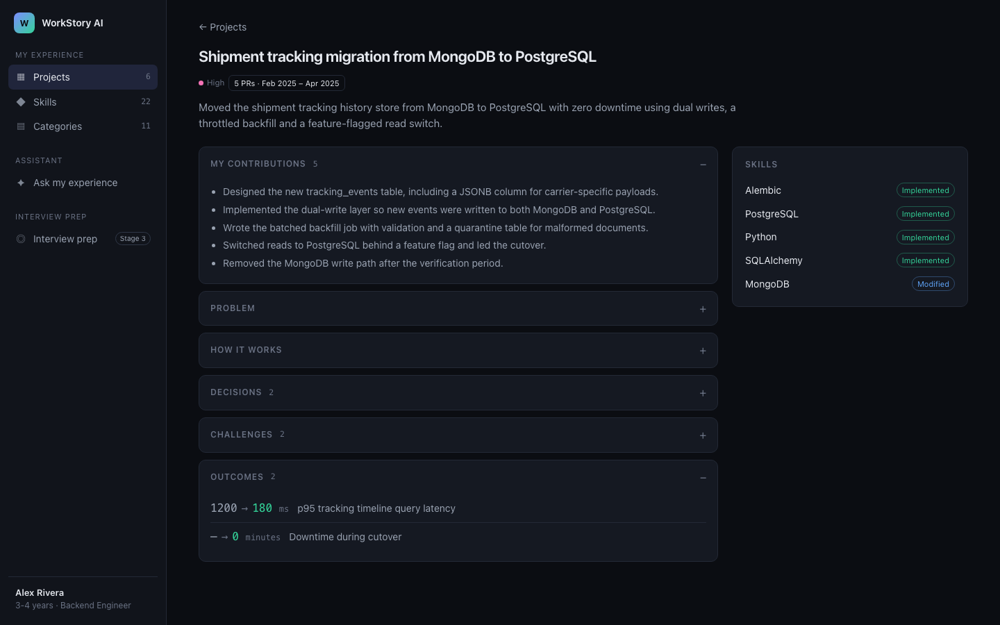
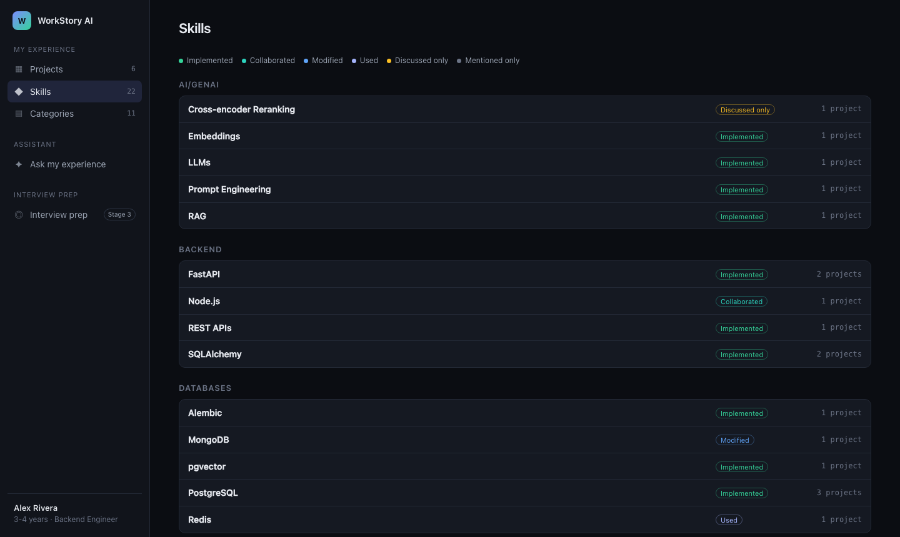
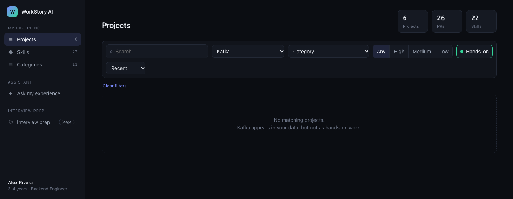
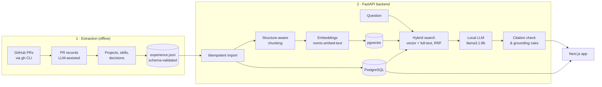

# WorkStory AI

**Turn your pull-request history into a searchable engineering portfolio — and ask it questions.**

WorkStory AI reconstructs the projects behind hundreds of PRs, stores them as structured data,
and answers questions like *"Have I worked on database migrations?"* with **evidence-backed
answers that cite the exact projects and PRs they come from**. Everything runs locally:
PostgreSQL + pgvector for search, and local models through Ollama for embeddings and answers.



> Screenshots and published numbers use the synthetic sample dataset (`examples/`),
> a fictional engineer. Real experience data never leaves the machine.

---

## What it does

| | |
|---|---|
| **Experience library** | Projects grouped from many PRs, with contributions, decisions, trade-offs, challenges and measured outcomes. Filter by skill, category, complexity — or **hands-on only**. |
| **Experience assistant** | Ask questions in plain English. Answers cite numbered evidence, are labelled *backed / partly backed / not enough evidence*, and never claim experience that isn't in the data. |
| **Honest by design** | Every skill records *how* it was used: implemented, collaborated, modified, used, **discussed**, mentioned. "Have I used Kafka?" → *only discussed, not used*. Low-confidence projects are flagged as unverified. |
| **Interview prep** *(in progress)* | Role-, JD- and project-based interview questions with answers grounded in your own work. |

<table>
<tr>
<td width="50%"></td>
<td width="50%"></td>
</tr>
<tr>
<td><sub>Answers cite evidence; each citation links to its project.</sub></td>
<td><sub>Project detail: contributions, decisions, challenges, outcomes, skills with involvement level.</sub></td>
</tr>
<tr>
<td></td>
<td></td>
</tr>
<tr>
<td><sub>Skills show the strongest level of involvement and the projects behind them.</sub></td>
<td><sub>"Hands-on only": Kafka exists in the data, but was only discussed.</sub></td>
</tr>
</table>

---

## How it works



### The RAG pipeline, step by step

1. **Chunking follows the data's structure**, not arbitrary text lengths: one chunk per project
   section (overview, contributions, implementation, each decision, each challenge, outcomes,
   skills) plus one per PR. Each chunk repeats its project name, so it stands alone when retrieved.
2. **Embeddings are incremental.** Chunks store a content hash; re-importing only re-embeds what
   changed. If the model is down, the import still succeeds and embedding resumes later.
3. **Hybrid retrieval.** pgvector cosine search (HNSW index) and PostgreSQL full-text search run
   side by side and are merged with **Reciprocal Rank Fusion** — no score normalisation needed.
4. **Grounded answers.** The model sees labelled evidence (`E1…E8`), must cite every claim, and
   replies in a JSON schema. The backend then **verifies** the reply: citations to unknown
   evidence are dropped, a claim of support without valid citations becomes *"not enough
   evidence"*, and a plain "No" can never count as experience.

---

## Evaluation

RAG quality is measured, not eyeballed. `workstory-eval` runs a labelled question set through
every search mode and the full assistant. Relevance is judged at project level.

**Sample dataset** (6 projects, 26 PRs, 77 chunks · 16 positive + 4 negative questions):

| Search mode | Hit@5 | Recall@5 | MRR |
|---|---|---|---|
| Vector only | 0.94 | 0.91 | 0.91 |
| Keyword only | **1.00** | **0.97** | 0.92 |
| **Hybrid (RRF)** | 0.94 | 0.91 | **0.95** |

| Full assistant | Passed |
|---|---|
| Questions with an answer in the data | 15 / 16 |
| Questions with **no** answer in the data (must refuse) | **4 / 4** |

**Private real-world dataset** (~870 PRs → 44 projects, 1,324 chunks · 44 + 8 questions):

| Search mode | Hit@5 | Recall@5 | MRR |
|---|---|---|---|
| Vector only | 0.91 | 0.71 | 0.78 |
| Keyword only | 0.89 | 0.73 | 0.72 |
| **Hybrid (RRF)** | **0.93** | **0.75** | **0.86** |

Full assistant: 39/44 answerable questions passed, **8/8 unanswerable questions correctly refused**.

**What the numbers show**

- On the small sample, the questions reuse the data's own words, so keyword search alone is
  enough. On real data, wording varies and hybrid wins on every metric — the benefit of hybrid
  retrieval grows with dataset size.
- The evaluation drove real fixes: removing generic question words ("features", "built") from
  keyword search, and treating "No." as no evidence, moved refusals from 7/8 to 8/8.
- Remaining misses are vocabulary gaps (e.g. "infrastructure as code" vs "Terraform"), the next
  target for improvement.

Full report: [`eval/results-sample.md`](eval/results-sample.md).

---

## Design decisions

| Decision | Why |
|---|---|
| **PostgreSQL + pgvector** instead of a separate vector database | One database for relational data, full-text and vectors; filters and joins stay in SQL. A few thousand chunks don't need more. |
| **No LangChain / LlamaIndex** | The pipeline is small and explicit: chunking, hybrid search, prompt, validation. Every step is visible and testable. |
| **Reciprocal Rank Fusion** | Merges vector and keyword rankings without normalising incompatible scores. |
| **Local models via Ollama** behind a provider interface | Free, private, offline. The `LLMProvider` interface lets a hosted model replace it without touching callers; tests use a deterministic fake. |
| **Structured JSON as the contract** between extraction and app | The app never depends on how data was extracted. Anyone can generate the file their own way, and it is validated before import. |
| **Snapshot imports** keyed by stable IDs | Re-importing is idempotent; removed records disappear; skill and category IDs stay stable. |
| **Validate the model's output** instead of trusting the prompt | Small local models follow rules loosely; the backend enforces citations and support levels. |
| **Involvement levels and confidence** in the schema | Prevents the most common failure of "AI résumé" tools: overstating experience. |

---

## Tech stack

**Backend** Python 3.12 · FastAPI · SQLAlchemy 2 · Alembic · PostgreSQL 17 · pgvector · Pydantic · pytest
**AI** Ollama · nomic-embed-text (768-d embeddings) · llama3.1:8b with JSON-schema outputs
**Frontend** Next.js 16 (App Router, Server Components, Server Actions) · TypeScript
**Tooling** Docker Compose · uv · Ruff · GitHub CLI

---

## Getting started

Requirements: Docker, [uv](https://docs.astral.sh/uv/), Node.js 20+, [Ollama](https://ollama.com).

```bash
# Models (one-time, ~5 GB)
ollama serve                      # or open the Ollama app
ollama pull nomic-embed-text
ollama pull llama3.1:8b

# Database (PostgreSQL + pgvector on port 5433)
docker compose up -d

# Backend → http://localhost:8000 (API docs at /docs)
cd backend
uv sync
uv run alembic upgrade head
uv run workstory-import ../examples/sample-experience.json   # import + embed sample data
uv run uvicorn app.main:app --reload

# Frontend → http://localhost:3000 (in another terminal)
cd frontend
npm install
npm run dev
```

Useful commands (from `backend/`):

```bash
uv run pytest                                            # 150+ tests (DB tests need Docker running)
uv run workstory-validate file.json                      # check an experience file
uv run workstory-embed                                   # embed chunks still missing embeddings
uv run workstory-eval ../examples/eval-questions.json --answers   # run the evaluation
```

---

## Use it with your own data

The extraction kit in [`extraction/`](extraction) builds your experience file from GitHub:

```bash
python extraction/fetch_prs.py                     # your authored PRs (read-only, no diffs)
python extraction/fetch_prs.py --author old-login  # PRs from another account you used
python extraction/fetch_repos.py you/side-project  # personal repos without PRs
```

Then turn the raw PRs into records and projects with an LLM, following
[`extraction/prompts/`](extraction/prompts), and assemble + validate:

```bash
cd backend && uv run python ../extraction/assemble.py   # → data/workstory-experience.json
uv run workstory-import ../data/workstory-experience.json
```

Everything under `data/` is git-ignored. If your PRs belong to an employer, check that you are
allowed to use them first, and review the extracted file before importing — the prompts strip
secrets, hostnames and customer names, but you are the final check.

---

## Project structure

```
backend/      FastAPI app: schema, import, chunking, embeddings, retrieval, assistant, evaluation
frontend/     Next.js app: experience library and assistant
extraction/   Scripts and prompts to build an experience file from GitHub
examples/     Synthetic sample dataset and evaluation questions
eval/         Evaluation reports (sample data)
docs/         Screenshots
data/         Your private data — git-ignored
```

## Roadmap

- [x] Experience library (projects, skills, categories, filters)
- [x] Hybrid RAG assistant with citations and grounding checks
- [x] Retrieval and answer evaluation
- [ ] Interview prep: role-, JD- and project-based questions with grounded answers
- [ ] Query expansion for vocabulary gaps; category-aware retrieval
- [ ] Full Docker setup for the whole stack
